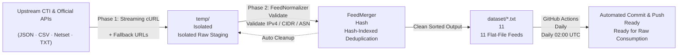

<a id="top"></a>

> [!WARNING]
>
> ### 🚨 Repository Moved — Please Migrate Before December 5, 2026
>
> This repository has permanently moved to **[`aozora-kenzu/IP-Threats-Collections`](https://github.com/aozora-kenzu/IP-Threats-Collections)**.
>
> - **Deprecation / Sunset Date:** **December 5, 2026** _(1-week grace period from November 28, 2026)_.
> - **What happens after December 5, 2026:** Automated daily dataset updates in this repository will be **discontinued**, and this repository will be **archived** as read-only.
> - **What's improved in the new repository:** Datasets are now published cleanly via **GitHub Releases** (individual `.txt` feeds, compressed `.zip` / `.tar.gz` bundles, and `SHA256SUMS.txt` verification) instead of daily Git commits — keeping the repository lightweight and fast to pull.
>
> #### Quick URL Migration
>
> Replace your old `raw.githubusercontent.com` download URLs with the permanent **GitHub Releases** URLs:
>
> ```bash
> # Old (deprecated after December 5, 2026)
> https://raw.githubusercontent.com/aozora-kenzu/Threats-Collections/main/dataset/firehol_level1.txt
>
> # New (recommended — always points to the latest daily build)
> https://github.com/aozora-kenzu/IP-Threats-Collections/releases/latest/download/firehol_level1.txt
> ```
>
> 👉 **[Go to the New Repository: `aozora-kenzu/IP-Threats-Collections`](https://github.com/aozora-kenzu/IP-Threats-Collections)**

---

<div align="center">

# 🛡️ Threats Collections _(Legacy)_

### Automated Cyber Threat Intelligence (CTI) Feeds, Verified Bot Validation & Cloud/Datacenter Detection

[](https://github.com/aozora-kenzu/IP-Threats-Collections)
[](https://github.com/aozora-kenzu/IP-Threats-Collections)
[](https://github.com/aozora-kenzu/Threats-Collections/actions/workflows/update-feeds.yml)
[](https://github.com/aozora-kenzu/Threats-Collections/commits/main)
[](LICENSE)

[](https://www.php.net/)
[](https://github.com/aozora-kenzu/Threats-Collections/stargazers)
[](https://github.com/aozora-kenzu/Threats-Collections/network/members)
[](.github/workflows/update-feeds.yml)
[](#dataset-catalog)
[](#dataset-catalog)

<p>
  <a href="https://github.com/aozora-kenzu/IP-Threats-Collections"><strong>New Repository</strong></a> •
  <a href="#overview">Overview</a> •
  <a href="#architecture">Architecture</a> •
  <a href="#dataset-catalog">Datasets</a> •
  <a href="#direct-consumption">Direct Pull</a> •
  <a href="#getting-started">Self-Hosting</a> •
  <a href="#automation">Automation</a> •
  <a href="#production-integrations">Integrations</a> •
  <a href="#license--attribution">License</a>
</p>

</div>

---

## Overview

**Threats Collections** is a zero-dependency, automated **Cyber Threat Intelligence (CTI)** aggregation and ETL pipeline built in pure PHP. It fetches, normalizes, validates, and deduplicates threat feeds from authoritative security communities and official cloud/search-engine APIs into clean, ready-to-consume flat text datasets in [`dataset/`](dataset/).

Whether you are hardening a reverse proxy, tuning a WAF, building an anti-fraud scoring engine, or protecting against credential stuffing and scraper abuse, this repository provides **daily-updated, machine-readable datasets** covering:

- **Malicious Infrastructure:** FireHOL Level 1 (malware/C2), FireHOL Level 2 (active 48h attackers), Spamhaus DROP (hijacked netblocks), and IPsum reputation scores.
- **Anonymizers & Proxies:** Commercial VPN CIDRs, Tor exit nodes, and ~2.94M94M aggregated open proxy endpoints.
- **Cloud & Datacenter Ranges (Anti-Bypass):** Direct integration with official AWS, Cloudflare, DigitalOcean, and Oracle Cloud (OCI) endpoints alongside community hosting lists.
- **Verified Bots (False-Positive Prevention):** Official IPv4 CIDR ranges for Googlebot, Bingbot, OpenAI GPTBot, OpenAI SearchBot, and Applebot to safely allowlist legitimate crawlers.
- **Global & Threat ASN Intelligence:** Malicious/datacenter ASN watchlists plus a 123K+ entry worldwide ASN-to-organization/country directory.

### Compatible Security Stack


---

## Architecture

The builder ([`gets.php`](gets.php) + [`helpers.php`](helpers.php)) executes a resilient **2-phase ETL pipeline** designed for high throughput, low memory overhead, and fault tolerance:



### Core Pipeline Modules

| Component                  | File                         | Responsibility                                                                                                                           |
| :------------------------- | :--------------------------- | :--------------------------------------------------------------------------------------------------------------------------------------- |
| **`ThreatDatasetBuilder`** | [`gets.php`](gets.php)       | Orchestrates Phase 1 downloads, Phase 2 merges, feed filtering (`--feed=`), and build summaries (CLI & Web).                             |
| **`FeedDownloader`**       | [`helpers.php`](helpers.php) | Memory-efficient streaming cURL downloader with automatic fallback URLs and custom User-Agent handling.                                  |
| **`FeedNormalizer`**       | [`helpers.php`](helpers.php) | Parses multi-format feeds (JSON, CSV, Netset, TXT), strips comments, validates IPv4/CIDR/ASN boundaries, and handles 32-bit subnet math. |
| **`FeedMerger`**           | [`helpers.php`](helpers.php) | Merges multi-source feeds, deduplicates entries via in-memory hash indexing, and writes normalized `.txt` artifacts.                     |
| **`FileUtils`**            | [`helpers.php`](helpers.php) | Manages isolated staging (`temp/`) and output (`dataset/`) directories with automatic post-build cleanup.                                |

---

## Dataset Catalog

All compiled feeds are stored as clean, deduplicated UTF-8 flat files in [`dataset/`](dataset/) and refreshed automatically every day at **02:00 UTC (09:00 WIB)** until **December 5, 2026**.

| Dataset File                                                 |                                                                                   Raw Pull                                                                                   | Category                    | Format                      | Approx. Entries | Upstream Sources                                                                                                                                                                                                                                                                                                                                          |
| :----------------------------------------------------------- | :--------------------------------------------------------------------------------------------------------------------------------------------------------------------------: | :-------------------------- | :-------------------------- | :-------------: | :-------------------------------------------------------------------------------------------------------------------------------------------------------------------------------------------------------------------------------------------------------------------------------------------------------------------------------------------------------- |
| [`dataset/vpn.txt`](dataset/vpn.txt)                         |        [](https://raw.githubusercontent.com/aozora-kenzu/Threats-Collections/main/dataset/vpn.txt)        | Commercial VPNs             | `CIDR`                      |      ~96K       | [X4BNet](https://github.com/X4BNet/lists_vpn), [Joseph Rocca](https://github.com/josephrocca/is-vpn)                                                                                                                                                                                                                                                      |
| [`dataset/datacenter.txt`](dataset/datacenter.txt)           |    [](https://raw.githubusercontent.com/aozora-kenzu/Threats-Collections/main/dataset/datacenter.txt)     | Cloud & Datacenters         | `CIDR`                      |      ~106K      | [AWS](https://ip-ranges.amazonaws.com/ip-ranges.json), [Cloudflare](https://www.cloudflare.com/ips-v4), [DigitalOcean](https://digitalocean.com/geo/google.csv), [Oracle OCI](https://docs.oracle.com/en-us/iaas/tools/public_ip_ranges.json), [X4BNet](https://github.com/X4BNet/lists_vpn), [Jhassine](https://github.com/jhassine/server-ip-addresses) |
| [`dataset/verified_bots.txt`](dataset/verified_bots.txt)     |  [](https://raw.githubusercontent.com/aozora-kenzu/Threats-Collections/main/dataset/verified_bots.txt)  | Verified Crawlers & AI Bots | `TSV (CIDR, Bot, Category)` |      ~270       | [Googlebot](https://developers.google.com/static/search/apis/ipranges/googlebot.json), [Bingbot](https://www.bing.com/toolbox/bingbot.json), [OpenAI](https://platform.openai.com/docs/bots), [Applebot](https://search.developer.apple.com/applebot.json)                                                                                                |
| [`dataset/firehol_proxies.txt`](dataset/firehol_proxies.txt) |  [](https://raw.githubusercontent.com/aozora-kenzu/Threats-Collections/main/dataset/firehol_proxies.txt)  | Open HTTP/SOCKS Proxies     | `CIDR`                      |     ~2.94M      | [FireHOL Proxies](https://github.com/firehol/blocklist-ipsets)                                                                                                                                                                                                                                                                                            |
| [`dataset/ipsum.txt`](dataset/ipsum.txt)                     |      [](https://raw.githubusercontent.com/aozora-kenzu/Threats-Collections/main/dataset/ipsum.txt)      | Scored Abusive IPs          | `TSV (IP, Hits)`            |      ~145K      | [Stamparm IPsum](https://github.com/stamparm/ipsum)                                                                                                                                                                                                                                                                                                       |
| [`dataset/firehol_level2.txt`](dataset/firehol_level2.txt)   |  [](https://raw.githubusercontent.com/aozora-kenzu/Threats-Collections/main/dataset/firehol_level2.txt)   | Active Attackers (48h)      | `CIDR`                      |     ~15.7K      | [FireHOL Level 2](https://github.com/firehol/blocklist-ipsets)                                                                                                                                                                                                                                                                                            |
| [`dataset/firehol_level1.txt`](dataset/firehol_level1.txt)   |  [](https://raw.githubusercontent.com/aozora-kenzu/Threats-Collections/main/dataset/firehol_level1.txt)   | Cybercrime, Malware & C2    | `CIDR`                      |      ~4.6K      | [FireHOL Level 1](https://github.com/firehol/blocklist-ipsets)                                                                                                                                                                                                                                                                                            |
| [`dataset/spamhaus_drop.txt`](dataset/spamhaus_drop.txt)     |   [](https://raw.githubusercontent.com/aozora-kenzu/Threats-Collections/main/dataset/spamhaus_drop.txt)   | Hijacked Networks (DROP)    | `CIDR`                      |      ~1.7K      | [Spamhaus DROP](https://www.spamhaus.org/drop/)                                                                                                                                                                                                                                                                                                           |
| [`dataset/tor_exit_nodes.txt`](dataset/tor_exit_nodes.txt)   |  [](https://raw.githubusercontent.com/aozora-kenzu/Threats-Collections/main/dataset/tor_exit_nodes.txt)   | Tor Anonymity Exit Nodes    | `IP`                        |      ~1.3K      | [SecOps Institute](https://github.com/SecOps-Institute/Tor-IP-Addresses), [The Tor Project](https://check.torproject.org/)                                                                                                                                                                                                                                |
| [`dataset/datacenter_asns.txt`](dataset/datacenter_asns.txt) | [](https://raw.githubusercontent.com/aozora-kenzu/Threats-Collections/main/dataset/datacenter_asns.txt) | Hosting, VPN & Bad ASNs     | `TSV (ASN, Name)`           |       ~1K       | [X4BNet](https://github.com/X4BNet/lists_vpn), [Enesutku](https://github.com/enesutku/ASN-List), [Brian Hama](https://github.com/brianhama/bad-asn-list)                                                                                                                                                                                                  |
| [`dataset/asn_names.txt`](dataset/asn_names.txt)             |    [](https://raw.githubusercontent.com/aozora-kenzu/Threats-Collections/main/dataset/asn_names.txt)    | Global ASN Directory        | `TSV (ASN, Name, Country)`  |      ~123K      | [RIPE NCC](https://ftp.ripe.net/ripe/asnames/asn.txt), [BGP.tools](https://bgp.tools/asns.csv)                                                                                                                                                                                                                                                            |

> [!IMPORTANT]
> For long-term integrations, use the **GitHub Releases** links in [`aozora-kenzu/IP-Threats-Collections`](https://github.com/aozora-kenzu/IP-Threats-Collections/releases/latest).

| Dataset File                                                 |                                                                               Raw Pull _(Legacy)_                                                                               |                                                                                   New Release Pull                                                                                   | Category                    | Format                      | Approx. Entries | Upstream Sources                                                                                                                                                                                                                                                                                                                                          |
| :----------------------------------------------------------- | :-----------------------------------------------------------------------------------------------------------------------------------------------------------------------------: | :----------------------------------------------------------------------------------------------------------------------------------------------------------------------------------: | :-------------------------- | :-------------------------- | :-------------: | :-------------------------------------------------------------------------------------------------------------------------------------------------------------------------------------------------------------------------------------------------------------------------------------------------------------------------------------------------------- |
| [`dataset/vpn.txt`](dataset/vpn.txt)                         |       [](https://raw.githubusercontent.com/aozora-kenzu/Threats-Collections/main/dataset/vpn.txt)       |       [](https://github.com/aozora-kenzu/IP-Threats-Collections/releases/latest/download/vpn.txt)       | Commercial VPNs             | `CIDR`                      |      ~96K       | [X4BNet](https://github.com/X4BNet/lists_vpn), [Joseph Rocca](https://github.com/josephrocca/is-vpn)                                                                                                                                                                                                                                                      |
| [`dataset/datacenter.txt`](dataset/datacenter.txt)           |   [](https://raw.githubusercontent.com/aozora-kenzu/Threats-Collections/main/dataset/datacenter.txt)    |   [](https://github.com/aozora-kenzu/IP-Threats-Collections/releases/latest/download/datacenter.txt)    | Cloud & Datacenters         | `CIDR`                      |      ~106K      | [AWS](https://ip-ranges.amazonaws.com/ip-ranges.json), [Cloudflare](https://www.cloudflare.com/ips-v4), [DigitalOcean](https://digitalocean.com/geo/google.csv), [Oracle OCI](https://docs.oracle.com/en-us/iaas/tools/public_ip_ranges.json), [X4BNet](https://github.com/X4BNet/lists_vpn), [Jhassine](https://github.com/jhassine/server-ip-addresses) |
| [`dataset/verified_bots.txt`](dataset/verified_bots.txt)     |  [](https://raw.githubusercontent.com/aozora-kenzu/Threats-Collections/main/dataset/verified_bots.txt)  |  [](https://github.com/aozora-kenzu/IP-Threats-Collections/releases/latest/download/verified_bots.txt)  | Verified Crawlers & AI Bots | `TSV (CIDR, Bot, Category)` |      ~270       | [Googlebot](https://developers.google.com/static/search/apis/ipranges/googlebot.json), [Bingbot](https://www.bing.com/toolbox/bingbot.json), [OpenAI](https://platform.openai.com/docs/bots), [Applebot](https://search.developer.apple.com/applebot.json)                                                                                                |
| [`dataset/firehol_proxies.txt`](dataset/firehol_proxies.txt) | [](https://raw.githubusercontent.com/aozora-kenzu/Threats-Collections/main/dataset/firehol_proxies.txt) | [](https://github.com/aozora-kenzu/IP-Threats-Collections/releases/latest/download/firehol_proxies.txt) | Open HTTP/SOCKS Proxies     | `CIDR`                      |     ~2.94M      | [FireHOL Proxies](https://github.com/firehol/blocklist-ipsets)                                                                                                                                                                                                                                                                                            |
| [`dataset/ipsum.txt`](dataset/ipsum.txt)                     |      [](https://raw.githubusercontent.com/aozora-kenzu/Threats-Collections/main/dataset/ipsum.txt)      |      [](https://github.com/aozora-kenzu/IP-Threats-Collections/releases/latest/download/ipsum.txt)      | Scored Abusive IPs          | `TSV (IP, Hits)`            |      ~145K      | [Stamparm IPsum](https://github.com/stamparm/ipsum)                                                                                                                                                                                                                                                                                                       |
| [`dataset/firehol_level2.txt`](dataset/firehol_level2.txt)   | [](https://raw.githubusercontent.com/aozora-kenzu/Threats-Collections/main/dataset/firehol_level2.txt)  | [](https://github.com/aozora-kenzu/IP-Threats-Collections/releases/latest/download/firehol_level2.txt)  | Active Attackers (48h)      | `CIDR`                      |     ~15.7K      | [FireHOL Level 2](https://github.com/firehol/blocklist-ipsets)                                                                                                                                                                                                                                                                                            |
| [`dataset/firehol_level1.txt`](dataset/firehol_level1.txt)   | [](https://raw.githubusercontent.com/aozora-kenzu/Threats-Collections/main/dataset/firehol_level1.txt)  | [](https://github.com/aozora-kenzu/IP-Threats-Collections/releases/latest/download/firehol_level1.txt)  | Cybercrime, Malware & C2    | `CIDR`                      |      ~4.6K      | [FireHOL Level 1](https://github.com/firehol/blocklist-ipsets)                                                                                                                                                                                                                                                                                            |
| [`dataset/spamhaus_drop.txt`](dataset/spamhaus_drop.txt)     |  [](https://raw.githubusercontent.com/aozora-kenzu/Threats-Collections/main/dataset/spamhaus_drop.txt)  |  [](https://github.com/aozora-kenzu/IP-Threats-Collections/releases/latest/download/spamhaus_drop.txt)  | Hijacked Networks (DROP)    | `CIDR`                      |      ~1.7K      | [Spamhaus DROP](https://www.spamhaus.org/drop/)                                                                                                                                                                                                                                                                                                           |
| [`dataset/tor_exit_nodes.txt`](dataset/tor_exit_nodes.txt)   | [](https://raw.githubusercontent.com/aozora-kenzu/Threats-Collections/main/dataset/tor_exit_nodes.txt)  | [](https://github.com/aozora-kenzu/IP-Threats-Collections/releases/latest/download/tor_exit_nodes.txt)  | Tor Anonymity Exit Nodes    | `IP`                        |      ~1.3K      | [SecOps Institute](https://github.com/SecOps-Institute/Tor-IP-Addresses), [The Tor Project](https://check.torproject.org/)                                                                                                                                                                                                                                |
| [`dataset/datacenter_asns.txt`](dataset/datacenter_asns.txt) | [](https://raw.githubusercontent.com/aozora-kenzu/Threats-Collections/main/dataset/datacenter_asns.txt) | [](https://github.com/aozora-kenzu/IP-Threats-Collections/releases/latest/download/datacenter_asns.txt) | Hosting, VPN & Bad ASNs     | `TSV (ASN, Name)`           |       ~1K       | [X4BNet](https://github.com/X4BNet/lists_vpn), [Enesutku](https://github.com/enesutku/ASN-List), [Brian Hama](https://github.com/brianhama/bad-asn-list)                                                                                                                                                                                                  |
| [`dataset/asn_names.txt`](dataset/asn_names.txt)             |    [](https://raw.githubusercontent.com/aozora-kenzu/Threats-Collections/main/dataset/asn_names.txt)    |    [](https://github.com/aozora-kenzu/IP-Threats-Collections/releases/latest/download/asn_names.txt)    | Global ASN Directory        | `TSV (ASN, Name, Country)`  |      ~123K      | [RIPE NCC](https://ftp.ripe.net/ripe/asnames/asn.txt), [BGP.tools](https://bgp.tools/asns.csv)                                                                                                                                                                                                                                                            |

> [!NOTE]
> Entry counts are approximate snapshots and fluctuate dynamically as upstream threat feeds and official provider IP ranges update daily.

<details>
<summary><strong>Preview Dataset Formats (Sample Lines)</strong></summary>

#### Standard CIDR List (`vpn.txt`, `datacenter.txt`, `firehol_*.txt`, `spamhaus_drop.txt`)

```text
1.10.16.0/20
1.19.0.0/16
1.32.128.0/18
```

#### Standard IP List (`tor_exit_nodes.txt`)

```text
2.29.201.23
2.56.119.122
5.2.67.226
```

#### Verified Bots (`verified_bots.txt` — Tab-Separated: `CIDR`, `Bot`, `Category`)

```tsv
192.178.4.0/27	Googlebot	SEARCH_ENGINE
192.178.4.128/27	Googlebot	SEARCH_ENGINE
```

#### Scored Threat Feed (`ipsum.txt` — Tab-Separated: `IP`, `Blacklist Hits`)

```tsv
64.62.197.137	9
66.132.172.209	9
```

#### Threat ASNs (`datacenter_asns.txt` — Tab-Separated: `ASN`, `Organization`)

```tsv
1442	SureHosting Internet Solutions, Inc.
3223	VOXILITY, RO
```

#### Global ASN Directory (`asn_names.txt` — Tab-Separated: `ASN`, `Organization`, `ISO Country`)

```tsv
1	LVLT-1 - Level 3 Parent, LLC, US	US
2	UDEL-DCN - University of Delaware, US	US
```

</details>

---

## Direct Consumption

> [!WARNING]
> Please switch to the new **GitHub Releases** endpoints below before **December 5, 2026**:

```bash
# Recommended: Pull from the new IP-Threats-Collections repository (GitHub Releases)
curl -fsSL https://github.com/aozora-kenzu/IP-Threats-Collections/releases/latest/download/firehol_level1.txt -o firehol_level1.txt
curl -fsSL https://github.com/aozora-kenzu/IP-Threats-Collections/releases/latest/download/spamhaus_drop.txt -o spamhaus_drop.txt
curl -fsSL https://github.com/aozora-kenzu/IP-Threats-Collections/releases/latest/download/verified_bots.txt -o verified_bots.txt
```

---

## Repository Structure

```text
Threats-Collections/
├── .github/
│   └── workflows/
│       └── update-feeds.yml     # Daily GitHub Actions sync workflow (active until Dec 5, 2026)
├── dataset/                     # Clean, normalized, deduplicated flat-file datasets
│   ├── asn_names.txt            # Global ASN directory (RIPE NCC + BGP.tools)
│   ├── datacenter.txt           # Official Cloud + Datacenter CIDRs
│   ├── datacenter_asns.txt      # Datacenter, VPN & Bad ASNs
│   ├── firehol_level1.txt       # Severe cybercrime, malware & C2 CIDRs
│   ├── firehol_level2.txt       # Active 48h attackers CIDRs
│   ├── firehol_proxies.txt      # Aggregated open proxies CIDRs (~2.94M)
│   ├── ipsum.txt                # Scored malicious IPv4 addresses
│   ├── spamhaus_drop.txt        # Hijacked network CIDRs (Spamhaus DROP)
│   ├── tor_exit_nodes.txt       # Active Tor exit node IPs
│   ├── verified_bots.txt        # Official Search Engine & AI crawler CIDRs
│   └── vpn.txt                  # Commercial VPN CIDRs
├── gets.php                     # 2-phase ETL pipeline orchestrator (CLI & Web)
├── helpers.php                  # FileUtils, FeedDownloader, FeedNormalizer, FeedMerger
├── LICENSE                      # MIT License & upstream data disclaimer
├── .gitignore                   # Excludes temp/ staging and local cache files
└── README.md                    # Project documentation
```

---

## Getting Started

### Prerequisites

- **PHP** `8.0+` (`8.2` / `8.3` / `8.4` recommended)
- **Extensions:** `ext-curl`, `ext-mbstring`
- **Memory Limit:** `512M` minimum (`1024M` recommended when processing the full ~51MB `firehol_proxies.txt` dataset)

### 1. Clone the New Repository

```bash
git clone https://github.com/aozora-kenzu/IP-Threats-Collections.git
cd IP-Threats-Collections
```

### 2. Run via Terminal (CLI)

Build **all 11 datasets** in one pass:

```bash
php gets.php
```

Or isolate a **specific feed category** using `--feed=<name>`:

```bash
php gets.php --feed=bots       # Verified bots only (Googlebot, Bingbot, OpenAI, Applebot)
php gets.php --feed=dc         # Cloud & datacenter ranges only
php gets.php --feed=vpn        # Commercial VPN CIDRs only
php gets.php --feed=tor        # Tor exit nodes only
php gets.php --feed=proxies    # FireHOL aggregated proxies only (~51MB)
```

<details>
<summary><strong>Complete CLI <code>--feed</code> Filter Reference</strong></summary>

| Target Argument    | Accepted Aliases     | Output File(s)                                                    |
| :----------------- | :------------------- | :---------------------------------------------------------------- |
| `--feed=vpn`       | —                    | `dataset/vpn.txt`                                                 |
| `--feed=dc`        | `dch`, `cloud`       | `dataset/datacenter.txt`                                          |
| `--feed=bots`      | `bot`, `crawler`     | `dataset/verified_bots.txt`                                       |
| `--feed=tor`       | —                    | `dataset/tor_exit_nodes.txt`                                      |
| `--feed=ipsum`     | —                    | `dataset/ipsum.txt`                                               |
| `--feed=firehol`   | —                    | `firehol_level1.txt`, `firehol_level2.txt`, `firehol_proxies.txt` |
| `--feed=firehol1`  | —                    | `dataset/firehol_level1.txt`                                      |
| `--feed=firehol2`  | —                    | `dataset/firehol_level2.txt`                                      |
| `--feed=proxies`   | —                    | `dataset/firehol_proxies.txt`                                     |
| `--feed=spamhaus`  | `drop`               | `dataset/spamhaus_drop.txt`                                       |
| `--feed=asn`       | `custom_asn`         | `dataset/datacenter_asns.txt`                                     |
| `--feed=asn_names` | `directory`, `names` | `dataset/asn_names.txt`                                           |
| Target Argument    | Accepted Aliases     | Output File(s)                                                    |
| :---               | :---                 | :---                                                              |
| `--feed=vpn`       | —                    | `dataset/vpn.txt`                                                 |
| `--feed=dc`        | `dch`, `cloud`       | `dataset/datacenter.txt`                                          |
| `--feed=bots`      | `bot`, `crawler`     | `dataset/verified_bots.txt`                                       |
| `--feed=tor`       | —                    | `dataset/tor_exit_nodes.txt`                                      |
| `--feed=ipsum`     | —                    | `dataset/ipsum.txt`                                               |
| `--feed=firehol`   | —                    | `firehol_level1.txt`, `firehol_level2.txt`, `firehol_proxies.txt` |
| `--feed=firehol1`  | —                    | `dataset/firehol_level1.txt`                                      |
| `--feed=firehol2`  | —                    | `dataset/firehol_level2.txt`                                      |
| `--feed=proxies`   | —                    | `dataset/firehol_proxies.txt`                                     |
| `--feed=spamhaus`  | `drop`               | `dataset/spamhaus_drop.txt`                                       |
| `--feed=asn`       | `custom_asn`         | `dataset/datacenter_asns.txt`                                     |
| `--feed=asn_names` | `directory`, `names` | `dataset/asn_names.txt`                                           |

</details>

### 3. Run via Web Browser

Start PHP's built-in development server (or serve via Laragon, Apache, or Nginx):

```bash
php -S 127.0.0.1:8000
```

Trigger builds directly from your browser with real-time streamed plain-text logs:

- **Build All Datasets:** `http://127.0.0.1:8000/gets.php`
- **Build Verified Bots:** `http://127.0.0.1:8000/gets.php?feed=bots`
- **Build Cloud & Datacenters:** `http://127.0.0.1:8000/gets.php?feed=dc`

> [!WARNING]
> Do **not** expose `gets.php` publicly on a production web server without authentication or IP restrictions, as anyone could trigger resource-intensive outbound downloads.

---

## Automation

### 1. GitHub Actions (Serverless — Recommended)

This legacy repository's workflow in [`.github/workflows/update-feeds.yml`](.github/workflows/update-feeds.yml) will continue running daily at **02:00 UTC (09:00 WIB)** until **December 5, 2026**, after which automated updates will move exclusively to [`aozora-kenzu/IP-Threats-Collections`](https://github.com/aozora-kenzu/IP-Threats-Collections).

### 2. Linux Cron Job (Self-Hosted Server)

For self-hosted VPS or dedicated infrastructure, configure `crontab -e`:

```cron
# Full daily synchronization at 02:00 AM
0 2 * * * /usr/bin/php -d memory_limit=1024M /path/to/IP-Threats-Collections/gets.php >> /var/log/threat-feeds.log 2>&1

# High-frequency Tor Exit Node refresh every 2 hours
0 */2 * * * /usr/bin/php /path/to/IP-Threats-Collections/gets.php --feed=tor >> /var/log/tor-sync.log 2>&1
```

---

## Production Integrations

### 1. Nginx IP Blocking (`geo` Module)

Convert the flat CIDR feeds into Nginx `geo` format (`<cidr> 1;`) and enforce blocking at the edge:

```bash
# Generate Nginx-compatible geo map from FireHOL Level 1 & Spamhaus DROP
awk '{print $1 " 1;"}' dataset/firehol_level1.txt dataset/spamhaus_drop.txt \
  > /etc/nginx/conf.d/threat_blocklist.geo
```

```nginx
# /etc/nginx/nginx.conf (inside http {} block)
geo $is_threat {
    default 0;
    include /etc/nginx/conf.d/threat_blocklist.geo;
}

server {
    listen 80;
    server_name example.com;

    if ($is_threat) {
        return 403 "Access Denied by Threat Intelligence Policy";
    }
}
```

### 2. Linux Kernel Filtering (`ipset` + `iptables`)

Block severe threat networks at wire speed with minimal CPU overhead using atomic `ipset` swaps:

```bash
#!/usr/bin/env bash
set -euo pipefail

# Build a temporary ipset atomically (zero downtime during reload)
ipset create threat_blocklist_tmp hash:net maxelem 262144 -exist
ipset flush threat_blocklist_tmp

awk '{print "add threat_blocklist_tmp " $1 " -exist"}' \
  dataset/firehol_level1.txt dataset/spamhaus_drop.txt | ipset restore

# Swap into production set
ipset create threat_blocklist hash:net maxelem 262144 -exist
ipset swap threat_blocklist_tmp threat_blocklist
ipset destroy threat_blocklist_tmp

# Enforce drop rule in iptables (add once)
iptables -C INPUT -m set --match-set threat_blocklist src -j DROP 2>/dev/null || \
  iptables -I INPUT -m set --match-set threat_blocklist src -j DROP
```

> [!TIP]
> Always evaluate [`dataset/verified_bots.txt`](dataset/verified_bots.txt) as an **allowlist before** blocking [`dataset/datacenter.txt`](dataset/datacenter.txt) or [`dataset/vpn.txt`](dataset/vpn.txt) to avoid accidentally blocking legitimate Google, Bing, Apple, or OpenAI crawlers hosted on cloud ranges.

---

## License & Attribution

### License

The pipeline source code ([`gets.php`](gets.php), [`helpers.php`](helpers.php), and workflow configurations) is open-source and licensed under the **[MIT License](LICENSE)**.

### Disclaimer

> [!CAUTION]
> These datasets are compiled strictly for **cybersecurity research, abuse mitigation, and fraud prevention**. Threat intelligence feeds are dynamic and may occasionally produce false positives. Always test blocking rules in monitor/log-only mode before enforcing hard blocks in production. Neither the maintainers nor upstream providers assume liability for downtime or blocking decisions.

### Upstream Data Providers

All rights to underlying threat intelligence and official IP ranges belong to their respective maintainers:

- **Official Crawlers & AI Bots:** [Google Search Central](https://developers.google.com/search/docs/crawling-indexing/googlebot-ip-ranges) · [Microsoft Bingbot](https://www.bing.com/toolbox/bingbot.json) · [OpenAI Crawlers](https://platform.openai.com/docs/bots) · [Applebot](https://support.apple.com/en-us/HT204683)
- **Cloud & Hosting Providers:** [Amazon Web Services (AWS)](https://docs.aws.amazon.com/general/latest/gr/aws-ip-ranges.html) · [Cloudflare](https://www.cloudflare.com/ips/) · [DigitalOcean](https://www.digitalocean.com/) · [Oracle Cloud (OCI)](https://docs.oracle.com/en-us/iaas/tools/public_ip_ranges.json) · [Jhassine Server IPs](https://github.com/jhassine/server-ip-addresses)
- **Threat Intelligence & Anonymizers:** [FireHOL IP Lists](https://iplists.firehol.org/) · [The Spamhaus Project](https://www.spamhaus.org/) · [The Tor Project](https://check.torproject.org/) · [SecOps Institute](https://github.com/SecOps-Institute/Tor-IP-Addresses) · [IPsum by Stamparm](https://github.com/stamparm/ipsum) · [X4BNet](https://github.com/X4BNet) · [Joseph Rocca](https://github.com/josephrocca/is-vpn)
- **ASN Intelligence & Directories:** [RIPE NCC](https://ftp.ripe.net/ripe/asnames/) · [BGP.tools](https://bgp.tools/) · [Enesutku ASN-List](https://github.com/enesutku/ASN-List) · [Brian Hama Bad ASN List](https://github.com/brianhama/bad-asn-list)

---

<div align="center">

🚀 **Please migrate to [`aozora-kenzu/IP-Threats-Collections`](https://github.com/aozora-kenzu/IP-Threats-Collections) before December 5, 2026!**

**[⬆ Back to Top](#toptop)**

</div>
